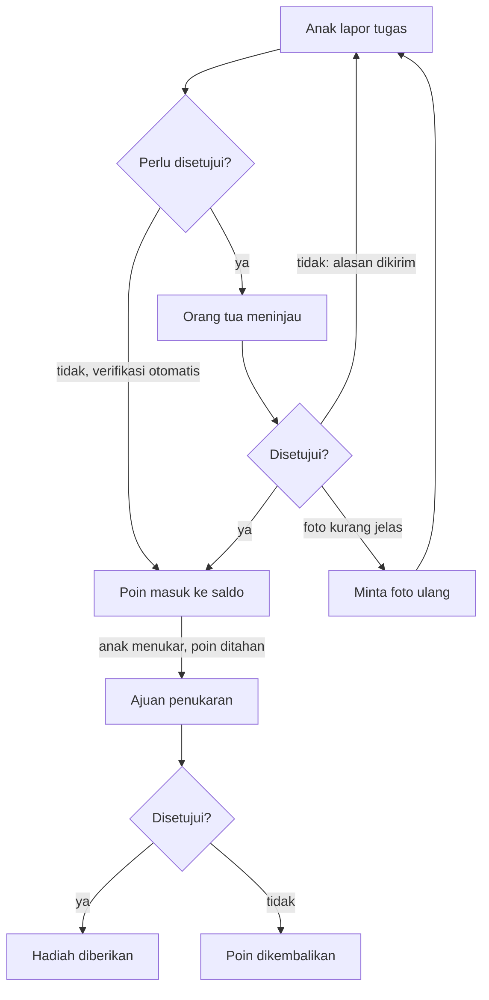

# PRD — Family Points App (Fase 1)

2 November 2026 · Refka

## Ringkasan produk

Family Points App (nama kerja) adalah aplikasi mobile iOS & Android tempat anggota keluarga mengumpulkan poin dari tugas yang dibuat orang tua, lalu menukarnya dengan hadiah yang sudah disepakati. Contohnya: 5.000 poin untuk makan di Solaria, atau 100 poin untuk 30 menit main game.

**Masalah.** Banyak orang tua di Indonesia kesulitan membatasi waktu anak di sosmed dan game. Larangan sepihak sering memicu konflik, dan aturan lisan mudah dilupakan atau ditawar.

**Solusi.** Waktu layar dan hadiah tidak lagi diberikan gratis, tapi "dibeli" dengan usaha. Anak belajar bahwa hal yang diinginkan perlu diperjuangkan. Orang tua mendapat sistem yang transparan, konsisten, dan tercatat.

**Visi.** Menjadi "dompet kebiasaan baik" keluarga Indonesia: tempat tanggung jawab, motivasi, dan reward bertemu dalam satu aplikasi yang menyenangkan.

**Fase 1** fokus pada sistem tugas, poin, dan hadiah. Pembatasan aplikasi masih dijalankan manual oleh orang tua, misalnya lewat Screen Time atau Family Link bawaan HP. Fitur blokir otomatis masuk ke fase berikutnya.

## Tujuan, non-goals, dan metrik sukses

Fase 1 harus membuktikan satu hal: keluarga mau memakai sistem poin ini secara rutin, minimal 4 minggu berturut-turut.

**Tujuan fase 1**

- Orang tua bisa menyiapkan tugas dan hadiah dalam waktu kurang dari 10 menit.
- Anak bisa melapor tugas selesai dan melihat progress poin dengan mudah, tanpa bantuan orang tua.
- Alur lapor → setujui → poin masuk berjalan realtime di dua HP yang berbeda.
- Penukaran hadiah tercatat jelas, termasuk hadiah screen time yang dijalankan manual.

**Non-goals fase 1**

- Memblokir atau membuka aplikasi lain secara otomatis (Screen Time API iOS, Accessibility Service Android).
- Memantau durasi pemakaian aplikasi lain.
- Pembayaran atau pembelian hadiah di dalam aplikasi.
- Fitur sosial antar keluarga yang berbeda.
- Versi web atau tablet khusus.

**Metrik sukses**

| Metrik | Target 3 bulan setelah rilis |
| --- | --- |
| Keluarga yang menyelesaikan setup (minimal 3 tugas + 2 hadiah + 1 anak terhubung) | ≥ 60% dari pendaftar |
| Retensi keluarga minggu ke-4 (ada tugas disetujui di minggu itu) | ≥ 35% |
| Rata-rata tugas disetujui per anak per minggu | ≥ 10 |
| Waktu rata-rata dari lapor sampai disetujui | ≤ 6 jam |
| Keluarga yang melakukan minimal 1 penukaran hadiah goal | ≥ 25% |
| Rating App Store / Play Store | ≥ 4,5 |

## Target pengguna dan peran

Pengguna utama adalah orang tua di Indonesia dengan anak usia 6–17 tahun yang sudah punya HP sendiri. Mereka yang membuat akun keluarga dan mengatur aturan main.

**Persona**

| Persona | Profil | Kebutuhan utama | Kekhawatiran |
| --- | --- | --- | --- |
| Ibu Rina (orang tua) | 36 tahun, pekerja kantoran, 2 anak usia 8 dan 13 | Anak mau bantu di rumah dan tidak main HP terus | Tidak punya waktu memantau setiap saat |
| Raka (anak remaja) | 13 tahun, suka Roblox dan TikTok | Bisa main tanpa diomeli, dan punya target yang jelas | Merasa aturannya tidak adil atau bisa berubah sewaktu-waktu |
| Kiara (anak SD) | 8 tahun, baru belajar membaca | Tampilan yang mudah dan menyenangkan | Tidak paham angka poin yang besar |
| Pasangan dewasa | Suami istri yang ingin saling membatasi pemakaian sosmed | Saling menyemangati, tanpa hierarki orang tua–anak | Terasa seperti diawasi |

**Peran dalam aplikasi**

| Peran | Bisa melakukan |
| --- | --- |
| Owner (orang tua pembuat keluarga) | Semua hak Admin, ditambah mengelola langganan, menghapus keluarga, dan mengalihkan kepemilikan |
| Admin (orang tua lain / pengasuh) | Membuat dan mengubah tugas & hadiah, menyetujui atau menolak laporan, memberi bonus/penalti, mengelola anggota |
| Member (anak atau anggota yang dibatasi) | Melihat tugas, melapor tugas selesai, melihat saldo & riwayat, menukar hadiah, mengatur goal pribadi |

Untuk penggunaan antar orang dewasa (pasangan), keduanya menjadi Admin dengan opsi **"ikut mengumpulkan poin"** aktif, sehingga mereka juga bisa melapor tugas dan menukar hadiah seperti Member. Laporan seseorang tidak bisa ia setujui sendiri; harus disetujui Admin lain. Karena itu, paket gratis mengizinkan 2 admin (lihat Monetisasi).

## Konsep inti dan ekonomi poin

Siklus utamanya: **orang tua membuat tugas dan hadiah → anak mengerjakan tugas → orang tua menyetujui → poin masuk → anak menabung atau menukar poin → hadiah diberikan.**

**Dua jenis hadiah**

| Jenis | Contoh | Cara pemenuhan di fase 1 |
| --- | --- | --- |
| Instan (screen time & hal kecil) | 30 menit game, 1 jam TikTok, pilih menu makan malam | Anak menukar → orang tua dapat notifikasi → orang tua membuka akses secara manual. Ada timer sesi di app anak sebagai pengingat |
| Goal (target besar) | Makan di Solaria, top-up game, mainan baru | Anak menyimpan poin dan melihat progress bar → saat cukup, anak mengajukan → orang tua mengonfirmasi dan menandai "sudah diberikan" |

Hadiah instan menjaga motivasi harian. Hadiah goal melatih kebiasaan menabung dan menunda kepuasan.

**Template ekonomi bawaan**

Orang tua memilih template saat setup agar tidak bingung menentukan angka. Semua nilai bisa diubah.

| Usia | Target poin per hari | Contoh harga 30 menit screen time | Contoh harga hadiah goal |
| --- | --- | --- | --- |
| 6–9 tahun | ±150 | 50 poin | 1.500–3.000 |
| 10–13 tahun | ±300 | 100 poin | 5.000–8.000 |
| 14–17 tahun | ±400 | 150 poin | 8.000–15.000 |

**Contoh tugas (template 10–13 tahun)**

| Tugas | Frekuensi | Poin | Verifikasi |
| --- | --- | --- | --- |
| Rapikan kasur | Harian | 20 | Otomatis |
| Bantu cuci piring | Harian | 50 | Persetujuan |
| Baca buku 30 menit | Berulang, maks 2×/hari | 60 | Persetujuan |
| PR selesai tanpa disuruh | Harian | 80 | Persetujuan + foto |
| Bersihkan kamar | Mingguan | 150 | Persetujuan + foto |
| Nilai ujian ≥ 85 | Sekali | 300 | Persetujuan + foto |

Dengan sekitar 300 poin per hari, hadiah 5.000 poin tercapai dalam kira-kira 2–3 minggu bila sebagian poin juga dipakai untuk screen time.

**Aturan ekonomi yang membuat sistem adil**

- **Harga terkunci.** Kenaikan harga hadiah yang sedang dijadikan goal oleh anak baru berlaku 7 hari kemudian, dan anak diberi notifikasi. Penurunan harga langsung berlaku.
- **Batas harian** per tugas mencegah anak mengulang tugas termudah terus-menerus.
- **Bonus streak.** Menyelesaikan minimal 1 tugas harian 7 hari berturut-turut memberi bonus 10% dari poin minggu itu (nilai bisa diatur).
- **Penalti opsional** dan selalu disertai alasan yang terlihat oleh anak.

## Kebutuhan fungsional

Fase 1 terdiri dari 9 modul (plus sub-modul bukti foto). Prioritas: **P0** wajib ada saat rilis, **P1** diusahakan masuk rilis, **P2** boleh menyusul di update berikutnya.

### 1. Akun dan onboarding

| ID | User story | Prioritas |
| --- | --- | --- |
| A-01 | Sebagai orang tua, saya bisa daftar dengan Google, Apple, atau nomor HP (OTP) | P0 |
| A-02 | Sebagai orang tua, saya bisa membuat keluarga dan memberi nama | P0 |
| A-03 | Sebagai orang tua, saya dipandu memilih template ekonomi sesuai usia anak | P0 |
| A-04 | Sebagai anak, saya bisa masuk dengan scan QR / kode undangan tanpa email | P0 |
| A-05 | Sebagai anak, saya bisa membuat PIN 4 digit untuk membuka app di HP bersama | P1 |

Kriteria penerimaan:

- Setup minimal (keluarga + 1 anak + 3 tugas + 2 hadiah) bisa selesai dalam ≤ 10 menit, dengan opsi "pakai template" yang mengisi tugas & hadiah contoh.
- Kode undangan berlaku 24 jam dan hanya bisa dipakai sekali.
- Akun anak tidak butuh email atau nomor HP.

### 2. Manajemen anggota

| ID | User story | Prioritas |
| --- | --- | --- |
| M-01 | Sebagai owner, saya bisa menambah anak (nama, avatar, tanggal lahir) | P0 |
| M-02 | Sebagai owner, saya bisa mengundang orang tua/pengasuh lain sebagai Admin | P0 |
| M-03 | Sebagai admin, saya bisa menonaktifkan atau menghapus anggota | P1 |
| M-04 | Sebagai admin, saya bisa melihat ringkasan semua anak di satu layar | P0 |

### 3. Tugas

| ID | User story | Prioritas |
| --- | --- | --- |
| T-01 | Sebagai admin, saya bisa membuat tugas: nama, ikon, poin, deskripsi | P0 |
| T-02 | Sebagai admin, saya bisa memilih frekuensi: sekali, harian, hari tertentu, mingguan, berulang | P0 |
| T-03 | Sebagai admin, saya bisa memilih verifikasi: otomatis, persetujuan, atau persetujuan + foto | P0 |
| T-04 | Sebagai admin, saya bisa menugaskan ke anak tertentu atau ke semua anak | P0 |
| T-05 | Sebagai admin, saya bisa mengatur batas berapa kali per hari tugas boleh dilaporkan | P0 |
| T-06 | Sebagai admin, saya bisa memberi tenggat (jam) dan pengingat | P1 |
| T-07 | Sebagai anak, saya bisa mengusulkan tugas baru untuk disetujui orang tua | P2 |
| T-08 | Sebagai admin, saya bisa mengarsipkan tugas tanpa menghapus riwayatnya | P0 |

Kriteria penerimaan:

- Tugas harian otomatis tersedia kembali pukul 00:00 waktu lokal keluarga.
- Mengubah poin tugas tidak mengubah poin yang sudah pernah diberikan.

### 4. Laporan dan persetujuan

| ID | User story | Prioritas |
| --- | --- | --- |
| L-01 | Sebagai anak, saya bisa menandai tugas selesai, dengan catatan opsional | P0 |
| L-02 | Sebagai anak, saya wajib upload foto bila tugas memintanya (lihat 4b) | P0 |
| L-03 | Sebagai admin, saya mendapat notifikasi dan bisa menyetujui/menolak dari daftar antrean | P0 |
| L-04 | Sebagai admin, saya bisa menolak dengan alasan, dan anak bisa melapor ulang | P0 |
| L-05 | Sebagai admin, saya bisa menyetujui banyak laporan sekaligus | P1 |
| L-06 | Sebagai admin, saya bisa memberi bonus poin saat menyetujui ("kerja bagus!") | P1 |

Kriteria penerimaan:

- Status laporan: Menunggu → Disetujui / Ditolak. Laporan yang menunggu lebih dari 72 jam diberi penanda dan admin diingatkan.
- Poin masuk ke saldo anak paling lambat 3 detik setelah disetujui (realtime).
- Foto bukti dikompres maksimal ±500 KB dan dihapus otomatis setelah 30 hari.

### 4b. Bukti foto (proof of work)

Untuk tugas yang diatur "wajib foto", anak harus memotret hasil kerjanya sebelum melapor, dan poin baru masuk setelah orang tua melihat foto itu lalu menyetujuinya.

| ID | User story | Prioritas |
| --- | --- | --- |
| PF-01 | Sebagai admin, saya bisa mengatur per tugas: wajib foto, dan jumlah minimal foto (1–3) | P0 |
| PF-02 | Sebagai anak, saya memotret langsung dari kamera di dalam app saat melapor | P0 |
| PF-03 | Sebagai anak, saya bisa melihat hasil foto, mengambil ulang, dan menambah catatan sebelum mengirim | P0 |
| PF-04 | Sebagai admin, saya melihat foto layar penuh, bisa zoom dan geser antar foto, lalu menyetujui atau menolak | P0 |
| PF-05 | Sebagai admin, saya bisa memilih "Minta foto ulang" bila foto kurang jelas, tanpa menolak tugasnya | P0 |
| PF-06 | Sebagai admin, saya bisa mengaktifkan mode "sebelum & sesudah" (mis. kamar berantakan → rapi) | P1 |
| PF-07 | Sebagai admin, saya bisa mengizinkan upload dari galeri untuk tugas tertentu (mis. foto nilai ujian dari guru) | P1 |
| PF-08 | Sebagai anak dan admin, saya bisa melihat galeri bukti per anak selama 30 hari terakhir | P1 |
| PF-09 | Sebagai admin, saya bisa memberi komentar atau stiker pujian di foto | P2 |
| PF-10 | Sebagai admin, saya bisa menandai foto sebagai "kenangan" agar tidak terhapus otomatis | P2 |

Kriteria penerimaan:

- Default hanya kamera in-app. Galeri dimatikan agar anak tidak memakai foto lama, kecuali admin mengizinkan per tugas (PF-07).
- Setiap foto diberi stempel waktu, nama anak, dan nama tugas di pojok gambar, serta menyimpan waktu pengambilan di server.
- Tombol "Kirim" baru aktif bila jumlah foto minimal sudah terpenuhi.
- Status laporan berfoto: Menunggu → Disetujui / Ditolak / Perlu foto ulang. "Perlu foto ulang" tidak memutus streak dan tidak memerlukan laporan baru.
- Foto dikompres ±500 KB, diunggah dengan progress bar, dan diantre ulang otomatis bila sinyal putus.
- Foto disimpan di storage privat, hanya bisa dibuka anggota keluarga lewat URL bertanda tangan yang kedaluwarsa, dan dihapus otomatis setelah 30 hari kecuali ditandai kenangan.

Data tambahan: tabel `submission_photos` (id, submission_id, kind: single/before/after, storage_path, taken_at, source: camera/gallery, is_kept, deleted_at), dan status `needs_retake` di `task_submissions`.

### 5. Poin dan dompet

| ID | User story | Prioritas |
| --- | --- | --- |
| P-01 | Sebagai anak, saya bisa melihat saldo poin saat ini di beranda | P0 |
| P-02 | Sebagai anak dan admin, saya bisa melihat riwayat transaksi poin (masuk/keluar, sumber, tanggal) | P0 |
| P-03 | Sebagai admin, saya bisa memberi bonus atau penalti manual dengan alasan wajib | P0 |
| P-04 | Sebagai admin, saya bisa membatalkan transaksi yang salah (reversal, bukan hapus) | P1 |

Kriteria penerimaan:

- Saldo selalu dihitung dari riwayat transaksi (ledger), tidak disimpan sebagai angka yang diubah langsung.
- Saldo tidak boleh negatif, dengan dua pengecualian: admin mengizinkan penalti melebihi saldo, atau pembatalan tugas otomatis (aturan bisnis no. 3). Saldo negatif ditampilkan sebagai "utang poin" dan dilunasi otomatis dari poin berikutnya.
- Poin tabungan goal (G-03) tetap tercatat di ledger, di "kantong" terpisah dari saldo tersedia (lihat Model data).

### 6. Hadiah dan penukaran

| ID | User story | Prioritas |
| --- | --- | --- |
| H-01 | Sebagai admin, saya bisa membuat hadiah: nama, gambar, harga poin, jenis (instan/goal) | P0 |
| H-02 | Sebagai admin, saya bisa membatasi stok atau frekuensi hadiah (mis. maks 2× screen time per hari) | P0 |
| H-03 | Sebagai anak, saya bisa menukar hadiah bila poin cukup | P0 |
| H-04 | Sebagai admin, saya bisa mengatur apakah penukaran perlu persetujuan | P0 |
| H-05 | Sebagai admin, saya bisa menandai hadiah "sudah diberikan" | P0 |
| H-06 | Sebagai anak, saya melihat timer sesi berjalan untuk hadiah screen time | P1 |
| H-07 | Sebagai admin, saya bisa menjadwalkan jam hadiah screen time boleh dipakai (mis. 16:00–20:00) | P2 |

Kriteria penerimaan:

- Saat ditukar, poin langsung ditahan (hold). Jika penukaran ditolak, poin dikembalikan penuh.
- Status penukaran: Diajukan → Disetujui → Diberikan, atau Ditolak / Dibatalkan.

### 7. Goal dan progress

| ID | User story | Prioritas |
| --- | --- | --- |
| G-01 | Sebagai anak, saya bisa memilih satu hadiah goal sebagai target utama | P0 |
| G-02 | Sebagai anak, saya melihat progress bar dan estimasi hari tercapai | P0 |
| G-03 | Sebagai anak, saya bisa "menabung" poin khusus untuk goal agar tidak terpakai untuk screen time | P1 |
| G-04 | Sebagai anak, saya mendapat perayaan (animasi) saat goal tercapai | P1 |

### 8. Gamifikasi

| ID | User story | Prioritas |
| --- | --- | --- |
| X-01 | Sebagai anak, saya melihat streak harian dan bonus yang akan didapat | P1 |
| X-02 | Sebagai anak, saya naik level berdasarkan total poin seumur hidup | P2 |
| X-03 | Sebagai anak, saya mengumpulkan badge (mis. "7 hari rajin", "Penabung hebat") | P2 |
| X-04 | Sebagai admin, saya bisa menyalakan leaderboard antar saudara (default mati) | P2 |

### 9. Ringkasan dan pengaturan

| ID | User story | Prioritas |
| --- | --- | --- |
| R-01 | Sebagai admin, saya mendapat ringkasan mingguan per anak: tugas selesai, poin masuk/keluar, hadiah | P1 |
| R-02 | Sebagai admin, saya bisa mengatur zona waktu, bahasa (ID/EN), dan notifikasi | P0 |
| R-03 | Sebagai owner, saya bisa ekspor riwayat poin (CSV) | P2 |

## User flow utama

Semua poin masuk lewat persetujuan (atau verifikasi otomatis), dan poin yang ditukar ditahan dulu sampai orang tua menyetujui atau menolak.

**Flow 1 — Setup awal orang tua**

1. Daftar (Google / Apple / OTP).
2. Beri nama keluarga.
3. Tambah anak: nama, avatar, tanggal lahir.
4. Pilih template ekonomi sesuai usia → tugas & hadiah contoh terisi otomatis.
5. Review dan ubah tugas, poin, serta hadiah.
6. Tampilkan QR/kode undangan untuk HP anak.

**Flow 2 — Anak bergabung**

1. Instal app → pilih "Saya anak".
2. Scan QR atau masukkan kode.
3. Pilih avatar dan buat PIN.
4. Masuk ke beranda dengan tugas hari ini.

**Flow 3 — Lapor tugas sampai poin masuk** (lihat diagram)

1. Anak membuka tugas → tekan "Selesai" → ambil foto bila wajib → kirim.
2. Bila verifikasi otomatis, poin langsung masuk. Bila tidak, status menjadi Menunggu dan orang tua mendapat notifikasi.
3. Orang tua meninjau → setujui (opsional + bonus), tolak dengan alasan, atau minta foto ulang.
4. Anak mendapat notifikasi dan animasi; bila ditolak, ia bisa memperbaiki lalu melapor ulang.

**Flow 4 — Tukar hadiah instan (screen time)**

1. Anak membuka Toko Hadiah → pilih "30 menit game" → konfirmasi.
2. Poin ditahan; orang tua mendapat notifikasi.
3. Orang tua menyetujui dan membuka akses secara manual (Screen Time / Family Link / memberikan HP).
4. Timer sesi berjalan di app anak, dengan peringatan 5 menit sebelum habis.
5. Bila ditolak atau dibatalkan, poin dikembalikan.

**Flow 5 — Menabung untuk goal**

1. Anak memilih "Makan di Solaria" sebagai goal.
2. Beranda menampilkan progress bar (mis. 3.200 / 5.000) dan estimasi "±6 hari lagi".
3. Saat poin cukup, anak menekan "Tukar" → orang tua menyetujui dan menjadwalkan.
4. Setelah hadiah diberikan, orang tua menandai "Sudah diberikan" → perayaan di app anak.

**Flow 6 — Bonus / penalti manual**

1. Orang tua membuka detail anak → Bonus atau Penalti.
2. Isi jumlah poin dan alasan (wajib).
3. Transaksi tercatat, anak mendapat notifikasi beserta alasannya.

## Daftar layar

Satu aplikasi dengan dua mode tampilan. Mode ditentukan oleh peran akun yang login: mode Orang Tua lebih padat informasi, mode Anak lebih visual dan ramah usia.

**Mode Orang Tua (tab bawah: Beranda · Persetujuan · Tugas · Hadiah · Keluarga)**

| # | Layar | Isi utama |
| --- | --- | --- |
| O-1 | Splash, login, daftar | Google / Apple / OTP nomor HP |
| O-2 | Onboarding keluarga | Nama keluarga → tambah anak → pilih template usia → review tugas & hadiah contoh |
| O-3 | Beranda | Kartu per anak (saldo, streak, goal), jumlah laporan menunggu, aktivitas terbaru |
| O-4 | Antrean persetujuan | Tab Laporan tugas & Penukaran hadiah; setujui/tolak cepat, pilih banyak |
| O-5 | Detail laporan | Foto bukti (layar penuh, zoom), catatan anak, tombol setujui + bonus / tolak + alasan / minta foto ulang |
| O-6 | Daftar tugas | Filter per anak & frekuensi, status aktif/arsip |
| O-7 | Buat / ubah tugas | Nama, ikon, poin, frekuensi, verifikasi, jumlah foto, batas harian, ditugaskan ke, pengingat |
| O-8 | Daftar hadiah | Kelompok Instan & Goal |
| O-9 | Buat / ubah hadiah | Nama, gambar, harga, jenis, durasi (screen time), stok/batas, perlu persetujuan |
| O-10 | Detail anak | Saldo, riwayat poin, goal, statistik minggu ini, galeri bukti, tombol bonus/penalti |
| O-11 | Bonus / penalti | Jumlah poin + alasan wajib |
| O-12 | Keluarga & anggota | Daftar anggota, undang admin, tambah anak, kode/QR undangan |
| O-13 | Ringkasan mingguan | Per anak: tugas selesai, poin masuk/keluar, hadiah diberikan |
| O-14 | Pengaturan | Profil, zona waktu, bahasa, notifikasi, aturan streak, langganan |

**Mode Anak (tab bawah: Beranda · Tugas · Hadiah · Riwayat)**

| # | Layar | Isi utama |
| --- | --- | --- |
| A-1 | Gabung keluarga | Scan QR / masukkan kode, pilih avatar, buat PIN |
| A-2 | Beranda | Saldo besar, progress goal + estimasi hari, streak, tugas hari ini |
| A-3 | Daftar tugas | Tugas hari ini & tersedia, status (belum / menunggu / disetujui / ditolak / perlu foto ulang) |
| A-4 | Lapor tugas | Konfirmasi, kamera in-app bila wajib foto (sebelum & sesudah bila aktif), preview & ambil ulang, catatan |
| A-5 | Toko hadiah | Kartu hadiah dengan harga; tanda "cukup" atau "kurang X poin" |
| A-6 | Konfirmasi tukar | Ringkasan harga & sisa saldo setelah tukar |
| A-7 | Sesi screen time | Timer hitung mundur, status "menunggu dibuka orang tua" |
| A-8 | Pilih goal | Pilih hadiah goal, atur tabungan khusus goal |
| A-9 | Riwayat | Transaksi poin dan status penukaran |
| A-10 | Perayaan | Animasi saat tugas disetujui, streak, atau goal tercapai |
| A-11 | Profil | Avatar, badge, level, ganti PIN |

Catatan desain: angka poin di mode anak usia 6–9 tahun sebaiknya ditampilkan dengan visual tambahan (misalnya bintang atau koin), karena angka ribuan sulit dipahami anak kecil.

## Aturan bisnis dan edge cases

**Aturan bisnis**

1. Poin hanya bisa bertambah lewat tugas yang disetujui (atau terverifikasi otomatis), bonus admin, bonus streak, atau pengembalian poin dari penukaran yang ditolak/dibatalkan. Anak tidak bisa menambah poin sendiri.
2. Setiap perubahan saldo dicatat sebagai transaksi dengan tipe, jumlah, sumber, pelaku, dan waktu. Transaksi tidak pernah dihapus; koreksi dilakukan dengan transaksi pembalik.
3. Tugas dengan verifikasi "otomatis" langsung memberi poin, tetapi tetap muncul di riwayat admin dan bisa dibatalkan dalam 24 jam. Bila poinnya sudah terpakai, pembatalan tetap berjalan dan saldo boleh menjadi negatif ("utang poin"); poin yang sedang ditahan untuk penukaran tidak ikut diambil.
4. Seseorang tidak bisa menyetujui laporan atau penukarannya sendiri.
5. Saat penukaran diajukan, poin langsung dipotong dari saldo sebagai transaksi `redeem_hold`. Bila disetujui, hanya status penukaran yang berubah (tidak ada transaksi baru). Bila ditolak atau dibatalkan, poin dikembalikan penuh lewat `redeem_release`.
6. Kenaikan harga hadiah yang sedang dijadikan goal oleh anak berlaku 7 hari setelah diubah, dan anak diberi notifikasi. Penurunan harga langsung berlaku.
7. Batas harian tugas dan hadiah dihitung per hari kalender di zona waktu keluarga.
8. Streak dihitung per tanggal laporan (`for_date`), bukan tanggal persetujuan. Satu hari dihitung "berhasil" bila ada minimal 1 laporan untuk tanggal itu yang disetujui. Selama masih ada laporan yang menunggu atau perlu foto ulang untuk tanggal itu, hari tersebut berstatus "tertunda" dan streak belum dianggap putus. Streak baru putus bila semua laporan untuk tanggal itu ditolak, atau tidak ada laporan sama sekali.

**Edge cases**

| Situasi | Perilaku yang diharapkan |
| --- | --- |
| Dua admin menyetujui laporan yang sama bersamaan | Hanya persetujuan pertama yang berlaku; admin kedua melihat pesan "sudah disetujui oleh X" |
| Anak melapor saat offline | Laporan disimpan di antrean lokal dan dikirim saat online; foto diunggah ulang otomatis |
| Tugas dihapus/diarsipkan saat ada laporan menunggu | Laporan tetap bisa diproses; tugas tidak muncul lagi untuk laporan baru |
| Poin anak berkurang karena penalti setelah ia mengajukan penukaran | Penukaran tetap memakai poin yang sudah ditahan; penalti diambil dari saldo tersisa |
| Orang tua lupa menyetujui berhari-hari | Pengingat harian ke admin; setelah 72 jam laporan diberi penanda, tidak disetujui otomatis |
| Anak menukar screen time tapi orang tua tidak membuka akses | Admin mendapat pengingat; anak bisa membatalkan dan poin kembali |
| Anak pindah HP / reinstall | Masuk ulang lewat kode dari admin; data tersimpan di server |
| HP dipakai bersama beberapa anak | Pilih profil + PIN saat membuka app |
| Owner ingin keluar dari keluarga | Wajib mengalihkan kepemilikan ke admin lain, atau menghapus keluarga |
| Foto bukti berisi konten tidak pantas | Admin bisa menghapus foto; foto hanya terlihat oleh anggota keluarga itu |
| Tugas otomatis dibatalkan setelah poinnya terpakai | Pembatalan tetap berjalan; saldo menjadi negatif dan tampil sebagai "utang poin" beserta alasannya |
| Harga hadiah goal diturunkan | Harga baru langsung berlaku dan progress bar anak diperbarui |
| Laporan masih menunggu saat hari berganti | Hari itu berstatus "tertunda" di streak; streak tidak putus sampai laporan diproses |

## Notifikasi

Notifikasi adalah penggerak utama alur persetujuan, jadi setiap jenisnya bisa dinyalakan atau dimatikan di pengaturan.

| Pemicu | Penerima | Contoh pesan | Default |
| --- | --- | --- | --- |
| Anak melapor tugas | Admin | "Raka menyelesaikan 'Cuci piring' — tinjau sekarang" | Nyala |
| Anak mengajukan penukaran | Admin | "Kiara ingin menukar 30 menit game (50 poin)" | Nyala |
| Laporan disetujui | Anak | "+50 poin! Cuci piring disetujui" | Nyala |
| Laporan ditolak | Anak | "Bersihkan kamar ditolak: lantai masih kotor. Coba lagi ya" | Nyala |
| Diminta foto ulang | Anak | "Fotonya kurang jelas, ambil ulang ya" | Nyala |
| Penukaran disetujui / diberikan | Anak | "Hore! 30 menit game sudah dibuka" | Nyala |
| Sesi screen time hampir habis | Anak | "Sisa 5 menit" | Nyala |
| Pengingat tugas harian | Anak | "Masih ada 3 tugas hari ini" (jam bisa diatur) | Nyala, 16:00 |
| Streak hampir putus | Anak | "Streak 6 hari! Selesaikan 1 tugas lagi hari ini" | Nyala, 19:00 |
| Goal tercapai | Anak & admin | "Poin Raka cukup untuk Makan di Solaria!" | Nyala |
| Laporan menunggu terlalu lama | Admin | "5 laporan menunggu persetujuanmu" | Nyala, 1×/hari |
| Ringkasan mingguan | Admin | "Minggu ini Raka menyelesaikan 18 tugas" | Nyala, Minggu 19:00 |
| Harga hadiah goal berubah | Anak | "Harga Makan di Solaria berubah jadi 5.500 mulai 9 Nov" | Nyala |

Semua notifikasi anak dikirim tanpa suara pada jam tidur yang diatur admin (default 21:00–06:00).

## Model data

Saldo poin tidak disimpan sebagai kolom yang diubah langsung, melainkan dihitung dari tabel `point_transactions` (pola ledger). Ini membuat riwayat selalu bisa diaudit dan mencegah saldo "hilang".

| Tabel | Kolom utama | Catatan |
| --- | --- | --- |
| `families` | id, name, timezone, locale, owner_id, plan, created_at | Satu keluarga = satu ruang data |
| `users` | id, auth_provider, email/phone, display_name, created_at | Akun login orang tua; anak boleh tanpa email |
| `members` | id, family_id, user_id (nullable), role (owner/admin/member), can_earn, name, avatar, birth_date, pin_hash, is_active | Anak bisa jadi member tanpa akun `users` penuh. `can_earn` selalu true untuk member; untuk owner/admin = opsi "ikut mengumpulkan poin" (pasangan dewasa) |
| `invites` | id, family_id, code, role, expires_at, used_by, used_at | Kode 6 karakter + QR, berlaku 24 jam |
| `tasks` | id, family_id, title, icon, description, points, frequency, days_of_week, max_per_day, verification (auto/approve/photo), min_photos, before_after, allow_gallery, due_time, is_archived, created_by | Poin di sini = nilai saat ini |
| `task_assignments` | task_id, member_id | Kosong = untuk semua anak |
| `task_submissions` | id, task_id, member_id, status (pending/approved/rejected/needs_retake), note, points_snapshot, for_date, reviewed_by, reviewed_at, reject_reason | `points_snapshot` mengunci nilai poin saat dilaporkan |
| `submission_photos` | id, submission_id, kind (single/before/after), storage_path, taken_at, source (camera/gallery), is_kept, deleted_at | Foto bukti, dihapus otomatis 30 hari kecuali `is_kept` |
| `rewards` | id, family_id, title, image_url, cost, type (instant/goal), duration_minutes, max_per_day, stock, needs_approval, is_archived, pending_cost, cost_effective_at | `pending_cost` untuk aturan perubahan harga 7 hari |
| `redemptions` | id, reward_id, member_id, cost_snapshot, status (requested/approved/fulfilled/rejected/cancelled), session_started_at, session_ends_at, reviewed_by | Sesi screen time dicatat di sini |
| `point_transactions` | id, member_id, bucket (available/goal), amount (+/−), type (task/bonus/penalty/streak/redeem_hold/redeem_release/reversal/goal_save/goal_unsave), ref_id, reason, created_by, created_at | Sumber kebenaran saldo dan tabungan goal |
| `goals` | id, member_id, reward_id, is_active, achieved_at | Satu goal aktif per anak. Jumlah tabungan dihitung dari ledger, tidak disimpan di sini |
| `streaks` | member_id, current_count, best_count, last_date | Diperbarui saat ada persetujuan |
| `badges` / `member_badges` | id, code, title / member_id, badge_id, earned_at | P2 |
| `devices` | id, user_id/member_id, push_token, platform | Untuk push notification |

**Rumus saldo:**

- Saldo tersedia = jumlah `point_transactions` milik anak dengan `bucket = available`.
- Tabungan goal = jumlah `point_transactions` milik anak dengan `bucket = goal`.
- Menabung untuk goal (G-03) dicatat sebagai dua baris dalam satu transaksi database: `goal_save` −X di kantong `available` dan `goal_save` +X di kantong `goal`. Menarik tabungan (`goal_unsave`) adalah kebalikannya.
- Poin yang ditukar dipotong lewat `redeem_hold` negatif dan dikembalikan lewat `redeem_release` bila ditolak/dibatalkan. Untuk hadiah goal, poin diambil dari kantong `goal` lebih dulu, lalu kekurangannya dari kantong `available`.

**Keamanan data:** setiap query dibatasi `family_id` lewat Row Level Security, sehingga anggota hanya bisa membaca data keluarganya sendiri. Member dengan peran anak hanya bisa membuat `task_submissions` dan `redemptions` atas namanya sendiri.

## Kebutuhan non-fungsional dan stack teknis

**Kebutuhan non-fungsional**

| Aspek | Kebutuhan |
| --- | --- |
| Platform | iOS 15+ dan Android 8+ (API 26), satu codebase |
| Performa | Buka app sampai beranda ≤ 2 detik di HP kelas menengah; sinkron persetujuan ≤ 3 detik |
| Offline | Lihat saldo & tugas, dan antre laporan saat offline; sinkron otomatis saat online |
| Ukuran app | ≤ 40 MB unduhan awal |
| Bahasa | Bahasa Indonesia (default) dan Inggris |
| Aksesibilitas | Ukuran teks dinamis, kontras warna AA, label untuk screen reader |
| Privasi anak | Data anak minimal (nama panggilan, avatar, tanggal lahir opsional); tanpa iklan di mode anak; mengikuti UU PDP Indonesia serta kebijakan Families di Google Play dan aturan Kids/Parental Control di App Store |
| Keamanan | PIN anak di-hash; foto disimpan di bucket privat dengan URL bertanda tangan; RLS per keluarga |
| Keandalan | Backup database harian; operasi poin bersifat atomik (transaksi database) |

**Stack yang disarankan**

| Lapisan | Pilihan | Alasan |
| --- | --- | --- |
| Aplikasi mobile | Flutter (atau React Native + Expo) | Satu codebase iOS & Android; nanti tetap bisa menambah native module untuk fitur blokir di fase 2 |
| Backend & database | Supabase (Postgres + Auth + Storage + Realtime) | RLS cocok untuk data per keluarga, realtime untuk persetujuan, Postgres cocok untuk pola ledger |
| Logika server | Supabase Edge Functions / database functions | Persetujuan, penukaran, dan streak dijalankan di server agar tidak bisa dimanipulasi dari HP |
| Push notification | Firebase Cloud Messaging (Android) + APNs (iOS), bisa lewat OneSignal | Standar dan gratis pada skala awal |
| Job terjadwal | pg_cron | Reset tugas harian, pengingat, ringkasan mingguan, perubahan harga 7 hari, hapus foto 30 hari |
| Analitik & crash | PostHog / Firebase Analytics + Crashlytics / Sentry | Mengukur metrik sukses fase 1 |
| Pembayaran langganan | RevenueCat | Satu SDK untuk App Store & Play Store |

Catatan: operasi yang mengubah poin (setujui laporan, tukar hadiah, bonus/penalti) wajib lewat fungsi server, bukan insert langsung dari aplikasi.

## Monetisasi, roadmap, risiko, dan pertanyaan terbuka

**Monetisasi (freemium)**

| Paket | Isi | Harga awal (usulan) |
| --- | --- | --- |
| Gratis | 1 anak, maks 10 tugas aktif, maks 5 hadiah aktif, maks 2 admin (agar pasangan bisa saling menyetujui) | Rp0 |
| Premium Keluarga | Anak & admin tak terbatas, foto bukti, ringkasan mingguan, badge, template ekonomi lengkap, ekspor | ±Rp29.000/bulan atau ±Rp199.000/tahun |

Harga perlu divalidasi lewat wawancara dengan 10–15 orang tua. Paket tahunan diberi potongan besar karena pasar Indonesia sensitif terhadap langganan bulanan. Tidak ada iklan di mode anak.

**Roadmap**

1. **Fase 0 — Validasi (2–3 minggu):** wireframe + prototipe Figma, uji dengan 5–10 keluarga, termasuk keluarga sendiri.
2. **Fase 1 — MVP (8–10 minggu):** semua P0 di dokumen ini, rilis beta tertutup (TestFlight & Play internal testing) lalu rilis publik.
3. **Fase 1.5 (4–6 minggu setelah rilis):** P1 dan sebagian P2 berdasarkan data pemakaian, plus langganan Premium.
4. **Fase 2 — Pembatasan otomatis:** iOS Screen Time API (FamilyControls, perlu pengajuan entitlement ke Apple sejak dini) dan Android (UsageStatsManager + mekanisme blokir yang lolos kebijakan Google Play). Penukaran screen time langsung membuka app yang dipilih selama durasinya.
5. **Fase 3 — Ekspansi:** widget layar utama, Apple Watch / Wear OS, tugas dari sekolah, hadiah dari mitra merchant.

**Risiko dan mitigasi**

| Risiko | Dampak | Mitigasi |
| --- | --- | --- |
| Orang tua lupa atau malas menyetujui | Anak kecewa dan berhenti memakai | Verifikasi otomatis untuk tugas ringan, persetujuan massal, pengingat harian |
| Ekonomi poin tidak seimbang | Hadiah terlalu mudah atau mustahil dicapai | Template per usia, estimasi "hari tercapai" saat orang tua menentukan harga |
| Tanpa blokir otomatis, anak tetap main di luar jatah | Nilai produk terasa lemah | Komunikasikan fase 1 sebagai alat kesepakatan keluarga; tampilkan panduan Screen Time/Family Link di dalam app |
| Anak merasa diawasi atau dihukum | Penolakan dari anak remaja | Penalti opsional dan transparan, anak bisa mengusulkan tugas, desain yang menyenangkan |
| Review App Store / Play Store untuk app anak | Rilis tertunda | Patuhi kebijakan Families/Kids sejak awal, tanpa SDK iklan, kebijakan privasi yang jelas |
| Pengajuan entitlement Family Controls di fase 2 lama atau ditolak | Fase 2 mundur | Ajukan begitu fase 1 rilis; fase 1 tetap bernilai tanpa fitur ini |

**Pertanyaan terbuka**

- [ ] Nama aplikasi final (usulan: PoinKu, Tabungan Bintang, FamPoin, Rajin)
- [ ] Flutter atau React Native, tergantung keahlian tim pengembang
- [ ] Apakah anak boleh punya akun di HP sendiri tanpa orang tua menyetujui perangkat?
- [ ] Apakah poin boleh kedaluwarsa, atau sebaliknya diberi "bunga tabungan"?
- [ ] Apakah leaderboard antar saudara diperlukan, atau justru memicu konflik?
- [ ] Validasi harga Premium dan batas paket gratis
- [ ] Usia minimum pengguna dan kebutuhan persetujuan orang tua sesuai UU PDP
