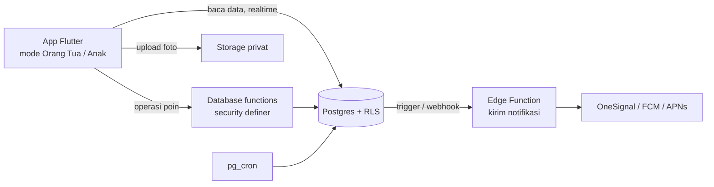

# Rencana Implementasi — Family Points App (Fase 1)

2 November 2026 · Refka · Turunan dari [PRD Fase 1](PRD-Family-Points-App-Fase-1.md)

## Ringkasan

MVP dikerjakan dalam **10 minggu**. Isinya semua fitur P0 di PRD, lalu diuji lewat beta tertutup dan dikirim ke App Store dan Play Store. Fitur P1 baru dikerjakan kalau masih ada waktu tersisa, dan sisanya masuk Fase 1.5.

Urutan kerja mengikuti siklus inti produk: **tugas → laporan → persetujuan → poin → penukaran**. Setiap tahap sudah bisa didemokan di dua HP sebelum lanjut ke tahap berikutnya.

## Asumsi

| Hal | Asumsi | Kalau berbeda |
| --- | --- | --- |
| Tim | 1 developer mobile, 1 developer backend/fullstack, 1 desainer paruh waktu | Dengan 1 developer saja, estimasi menjadi ±16 minggu |
| Stack | Flutter + Supabase (sesuai saran PRD) | React Native + Expo juga bisa; bagian backend tidak berubah |
| Fase 0 | Wireframe dan prototipe Figma sudah divalidasi sebelum minggu 1 | Tambah 2–3 minggu di depan |
| Akun developer | Apple Developer & Google Play Console sudah aktif | Urus di minggu 1, karena verifikasi bisa makan waktu beberapa hari |

## Keputusan yang perlu diambil sebelum minggu 1

1. **Flutter atau React Native.** Pilih sesuai keahlian developer mobile. Ini pertanyaan terbuka di PRD.
2. **Nama aplikasi dan bundle ID.** Dibutuhkan untuk mendaftarkan app di store, deep link QR undangan, dan konfigurasi push notification.
3. **Usia minimum dan bentuk persetujuan orang tua (UU PDP).** Ini menentukan alur daftar dan isi kebijakan privasi.
4. **Penyedia push:** FCM/APNs langsung atau lewat OneSignal. Saran: OneSignal, supaya lebih cepat jadi.

## Arsitektur ringkas

Prinsip yang dipegang dari awal:

- **Aplikasi hanya membaca data langsung.** Semua yang mengubah poin atau status dijalankan lewat database function (RPC). Akibatnya, RLS untuk `point_transactions`, `task_submissions.status`, dan `redemptions.status` tidak mengizinkan insert/update dari klien.
- **Saldo dihitung dari ledger.** Untuk performa, buat view `member_balances` (jumlah per `bucket`). Kalau nanti lambat, view itu bisa diganti materialized view atau tabel cache yang diperbarui trigger, dan ledger tetap jadi sumber kebenaran.
- **Ketersediaan tugas harian dihitung, bukan di-reset.** Tugas dianggap tersedia bila jumlah laporan untuk `for_date` (hari ini di zona waktu keluarga) masih di bawah `max_per_day`. Jadi tidak perlu cron reset tengah malam, dan tidak ada masalah zona waktu.
- **Login anak tanpa email.** Saat anak memasukkan kode undangan, app membuat sesi *anonymous sign-in* Supabase, lalu RPC `join_family` menautkan `auth.uid()` ke baris `members`. PIN disimpan sebagai hash di server dan hanya dipakai untuk mengganti profil di HP bersama.

## Daftar database function (RPC)

Setiap function berjalan dalam satu transaksi database, mengecek peran pemanggil, dan mengunci baris terkait (`SELECT … FOR UPDATE`) supaya dua admin tidak bisa memproses laporan yang sama.

| Function | Dipakai oleh | Isi singkat | PRD |
| --- | --- | --- | --- |
| `create_family` | Owner | Buat keluarga + member owner + isi template ekonomi | A-02, A-03 |
| `create_invite` / `join_family` | Admin / Anak | Kode 6 karakter berlaku 24 jam, hanya bisa dipakai sekali | A-04, M-02 |
| `submit_task` | Member | Cek batas harian & jumlah foto, simpan `points_snapshot`; bila verifikasi otomatis, langsung catat poin | L-01, L-02, T-05 |
| `review_submission` | Admin | Setujui (+ bonus opsional) / tolak + alasan / minta foto ulang; tolak bila reviewer = pelapor | L-03, L-04, PF-04, PF-05 |
| `reverse_auto_task` | Admin | Membatalkan tugas otomatis dalam 24 jam; boleh membuat saldo negatif | Aturan bisnis 3 |
| `adjust_points` | Admin | Bonus / penalti dengan alasan wajib | P-03 |
| `redeem_reward` | Member | Cek saldo, stok, dan batas harian, lalu catat `redeem_hold` | H-03 |
| `review_redemption` | Admin | Setujui / tolak (catat `redeem_release`) / tandai diberikan; sesi screen time mulai saat disetujui | H-04, H-05 |
| `cancel_redemption` | Member | Membatalkan penukaran yang belum diberikan; poin kembali | Edge case |
| `set_goal` | Member | Satu goal aktif per anak | G-01 |
| `update_reward_price` | Admin | Kenaikan harga hadiah goal disimpan ke `pending_cost` (berlaku 7 hari lagi); penurunan langsung berlaku | Aturan bisnis 6 |

## Job terjadwal (pg_cron)

| Job | Jadwal | Isi |
| --- | --- | --- |
| Terapkan harga tertunda | Tiap jam | `cost = pending_cost` bila `cost_effective_at` sudah lewat |
| Hapus foto lama | Harian | Hapus foto > 30 hari yang `is_kept = false` dari storage, isi `deleted_at` |
| Tandai laporan lama + pengingat admin | Harian | Tandai laporan > 72 jam, kirim "X laporan menunggu" |
| Pengingat tugas & streak | Tiap 15 menit | Kirim ke anak sesuai jam di zona waktu keluarga, kecuali jam tidur |
| Bonus streak | Harian, setelah hari berganti | Hitung streak 7 hari dan catat transaksi `streak` (hanya bila X-01 masuk rilis) |
| Hapus undangan kedaluwarsa | Harian | Bersih-bersih tabel `invites` |

## Jadwal per minggu

| Minggu | Fokus | Hasil yang bisa didemokan | ID PRD |
| --- | --- | --- | --- |
| 1 | **Fondasi** | Repo + CI, Supabase dev/staging/prod, skema awal + RLS, kerangka app dua mode, komponen desain dasar, akun store | — |
| 2 | **Akun & keluarga** | Daftar Google/Apple/OTP, buat keluarga, tambah anak, pilih template, anak bergabung lewat QR/kode | A-01–A-04, M-01, M-02 |
| 3 | **Tugas** | CRUD tugas (frekuensi, verifikasi, batas harian, penugasan, arsip); daftar tugas hari ini di mode anak | T-01–T-05, T-08, A-3 |
| 4 | **Laporan & persetujuan** | Anak lapor → admin menyetujui/menolak dari antrean → status anak berubah realtime; push notification dasar | L-01, L-03, L-04, O-4, O-5 |
| 5 | **Bukti foto** | Kamera in-app, preview & ambil ulang, stempel waktu, kompresi ±500 KB, upload + antre ulang, tampilan layar penuh + zoom, minta foto ulang | L-02, PF-01–PF-05 |
| 6 | **Dompet** | Saldo di beranda, riwayat transaksi, bonus/penalti, pembatalan tugas otomatis, beranda orang tua (kartu per anak) | P-01–P-03, M-04, O-3, O-10 |
| 7 | **Hadiah & goal** | CRUD hadiah, toko hadiah, tukar + hold, persetujuan & "sudah diberikan", goal + progress bar + estimasi hari, aturan harga 7 hari | H-01–H-05, G-01, G-02 |
| 8 | **Notifikasi, offline, pengaturan** | Semua notifikasi di PRD + jam tidur, antrean laporan offline, zona waktu & bahasa ID/EN, event analitik | R-02, NFR |
| 9 | **QA & beta tertutup** | Uji menyeluruh di HP kelas menengah, perbaikan bug, TestFlight & Play internal testing untuk 5–10 keluarga | — |
| 10 | **Perbaikan beta & rilis** | Perbaikan dari umpan balik beta, materi store, kebijakan privasi, kirim untuk review | — |

**Jalur P1 (kerjakan bila jadwal longgar, urut dari dampak terbesar):** L-05 persetujuan massal dan L-06 bonus saat menyetujui (mengurangi risiko orang tua malas menyetujui), A-05 PIN, X-01 streak, H-06 timer sesi, G-03 tabungan goal, R-01 ringkasan mingguan.

## Strategi pengujian

Fokus pengujian ada di poin, karena kesalahan di sini langsung merusak kepercayaan keluarga.

- **Tes database (pgTAP)** untuk setiap RPC dan kebijakan RLS:
  - Anggota keluarga A tidak bisa membaca data keluarga B.
  - Anak tidak bisa insert langsung ke `point_transactions` atau mengubah status laporan.
  - Admin tidak bisa menyetujui laporannya sendiri.
  - Penolakan penukaran selalu mengembalikan poin persis sama.
  - Saldo tidak bisa negatif, kecuali penalti yang diizinkan dan pembatalan tugas otomatis.
- **Tes konkurensi:** dua admin menyetujui laporan yang sama secara bersamaan → tepat satu transaksi poin.
- **Tes zona waktu:** batas harian dan streak di sekitar pukul 00:00 untuk WIB, WITA, dan WIT.
- **Tes widget/unit** di Flutter untuk alur lapor, kamera, dan antrean offline.
- **Uji manual dua HP** (satu iOS, satu Android) di akhir setiap minggu untuk alur yang baru selesai.

## Instrumentasi metrik sukses

Event analitik dipasang di minggu 8 supaya metrik PRD bisa diukur sejak beta:

`family_created`, `child_joined`, `setup_completed` (3 tugas + 2 hadiah + 1 anak), `task_submitted`, `submission_reviewed` (dengan durasi lapor → tinjau), `reward_redeemed` (jenis instan/goal), `goal_achieved`.

## Checklist rilis

- [ ] Kebijakan privasi & syarat layanan (UU PDP, data anak minimal)
- [ ] Google Play: formulir Families / target audience, Data safety, tanpa SDK iklan
- [ ] App Store: App Privacy, pilih kategori dengan hati-hati (bukan Kids Category kecuali siap dengan aturannya), Sign in with Apple
- [ ] Penghapusan akun dari dalam app (wajib di kedua store)
- [ ] Backup harian database aktif dan pernah diuji restore
- [ ] Crash reporting (Crashlytics/Sentry) aktif di build rilis
- [ ] Ajukan entitlement Family Controls ke Apple segera setelah rilis (persiapan Fase 2)

## Risiko teknis

| Risiko | Mitigasi |
| --- | --- |
| Sesi anonymous anak hilang saat reinstall | Masuk ulang lewat kode baru dari admin (sudah ada di edge case PRD); sesi lama dicabut |
| Push notification tidak sampai (terutama Android yang agresif menghemat baterai) | Antrean di app tetap jadi sumber kebenaran; badge jumlah laporan menunggu dihitung dari data, bukan dari notifikasi |
| Upload foto gagal di sinyal lemah | Kompresi di HP, upload bisa dilanjutkan, laporan baru dikirim setelah semua foto terunggah |
| Review store tertunda karena app untuk anak | Siapkan materi review sejak minggu 8, sertakan akun demo orang tua & anak |
| View saldo lambat bila transaksi sudah banyak | Index `(member_id, bucket)`; ganti ke tabel cache bila perlu, tanpa mengubah ledger |
